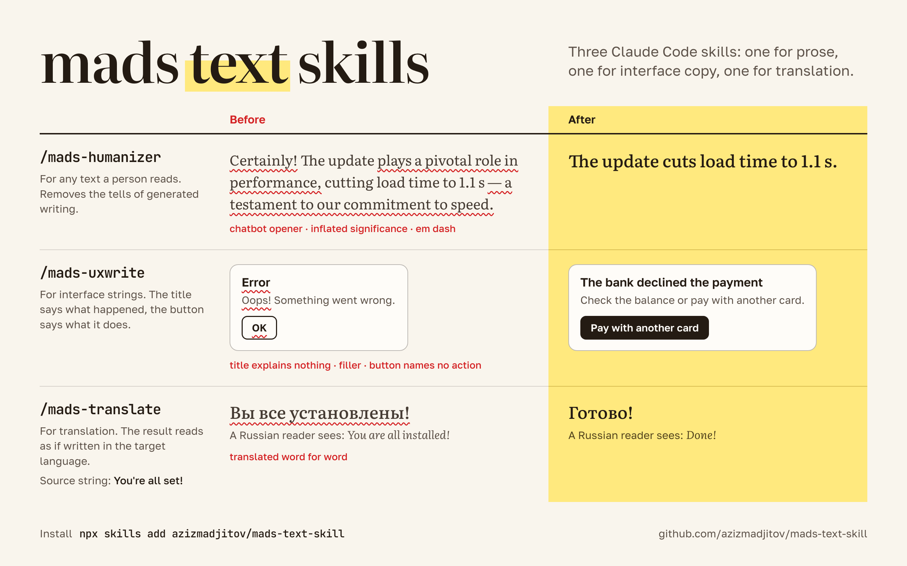

# mads text skills



Three skills for Claude Code. Each one is a set of rules that Claude loads before it writes a certain kind of text.

| Skill | Command | Claude uses it for |
|---|---|---|
| [mads-humanizer](mads-humanizer/SKILL.md) | `/mads-humanizer` | Any text a person will read, and requests to check a text for AI tells or rewrite it |
| [mads-uxwrite](mads-uxwrite/SKILL.md) | `/mads-uxwrite` | Interface strings: buttons, titles, field labels, errors, empty states, push notifications, string catalogs |
| [mads-translate](mads-translate/SKILL.md) | `/mads-translate` | Translating and localizing text or string files |

The files of mads-humanizer and mads-uxwrite are written in Russian. mads-translate is written in English.

## What each skill does

### mads-humanizer

The skill lists the patterns that mark generated text and bans them: inflated significance, promotional adjectives, chatbot openers and closers, closing summaries, vague authorities, the long dash. Most bans come with phrase lists in Russian and English, and each one says what to write in its place. Before sending a text Claude answers six check questions about it.

The rules come from the Russian Wikipedia essay [Признаки сгенерированности текста](https://ru.wikipedia.org/wiki/Википедия:Признаки_сгенерированности_текста) ("Signs of generated text") and apply to text in any language. The skill gives no guarantee that a text passes AI detectors such as GPTZero. It removes the patterns a reader notices.

### mads-uxwrite

Every interface string goes through two passes. The first pass decides what the string says: the title states what happened, the button names the action it triggers, the message tells the user what to do now. The second pass decides how the string is typeset: non-breaking spaces, real symbols such as −, ×, № and ², and the formats of numbers, dates and currency. [TYPOGRAPHY.md](mads-uxwrite/TYPOGRAPHY.md) covers rarer cases: phone and card numbers, ranges, abbreviations, lists.

The rules follow the Kontur guides on [screen typography](https://guides.kontur.ru/principles/text/typography/) and [interface text](https://guides.kontur.ru/principles/text/styleguide/). The cover shows English strings for readability. The skill itself is written for Russian interfaces: its examples and typesetting rules are Russian, and for English it adds two rules, on quotation marks and the decimal point.

### mads-translate

Claude translates the intent of a string. It works out what the string does, writes it the way a native author would, then checks the result for calques: source word order, passive voice, copied punctuation, false friends. Placeholders, markup tags, string keys, numbers and URLs stay as they are. In string files Claude translates values only.

The skill has an appendix for Russian: register, plural forms, typography, number and date formats, common calques from English.

## Install

With the [skills CLI](https://github.com/vercel-labs/skills):

```bash
npx skills add azizmadjitov/mads-text-skill
```

By default the CLI installs into the current project. Add `-g` to install for your user, `-s mads-translate` to install one skill, `-l` to list the skills without installing.

Without the CLI, clone the repository and copy the three folders:

```bash
git clone https://github.com/azizmadjitov/mads-text-skill.git
mkdir -p ~/.claude/skills
cp -R mads-text-skill/mads-* ~/.claude/skills/
```

To install for one project, copy the folders into `.claude/skills/` inside that project.

## Use

Type a command in Claude Code and add the task:

```
/mads-translate translate locales/en.json into Russian
```

Claude also loads a skill without the command when the task matches the skill description, for example when you ask it to translate a file.

## License

[MIT](LICENSE)
